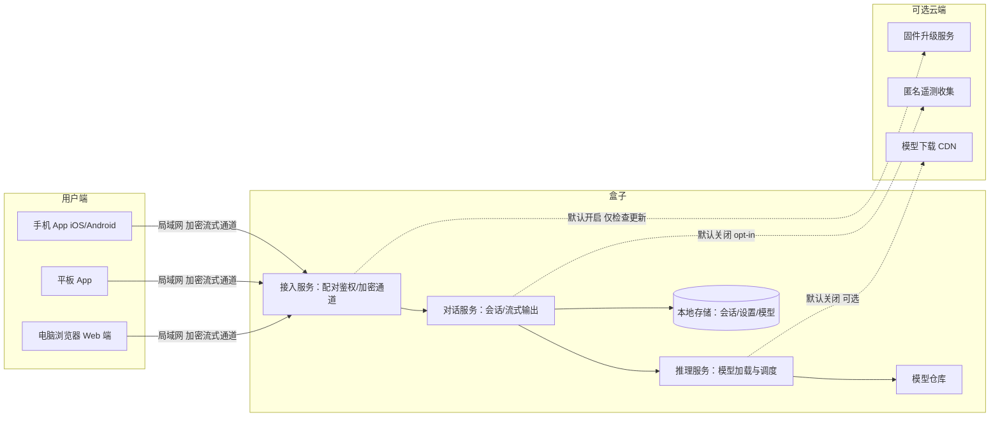
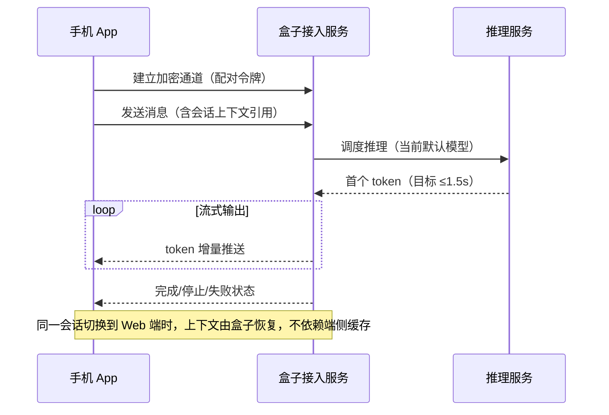
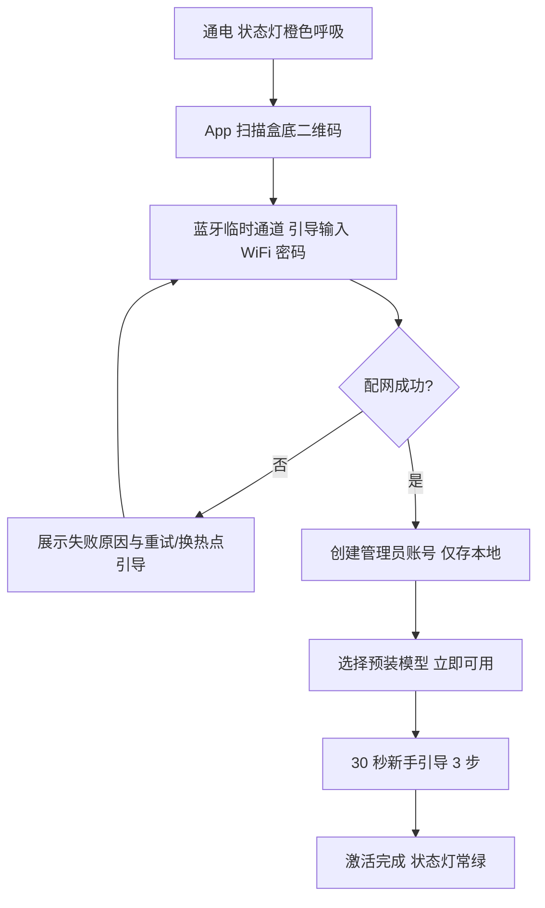
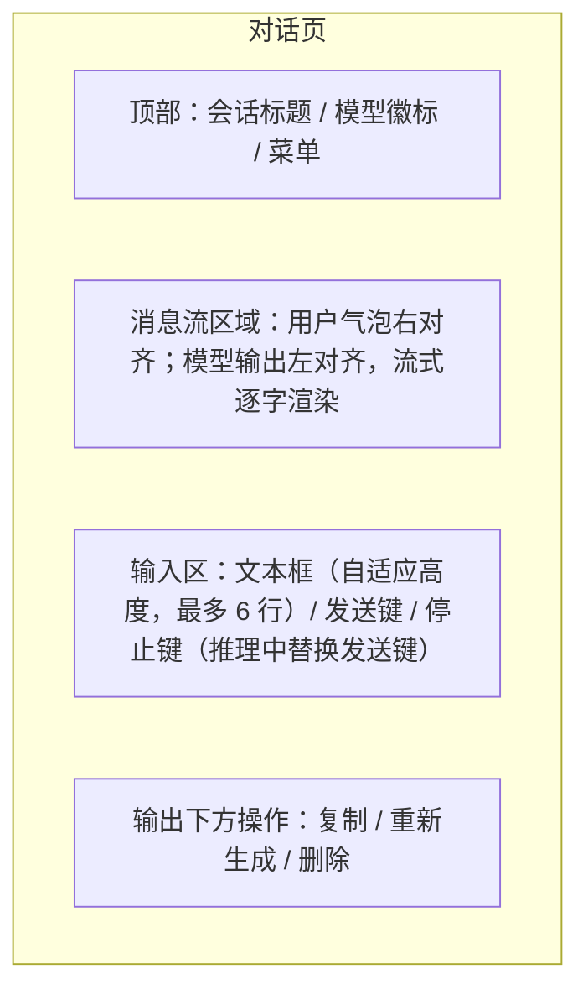
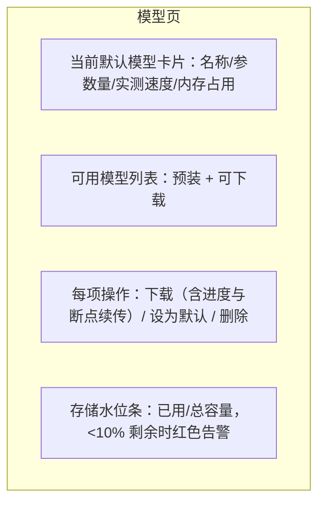
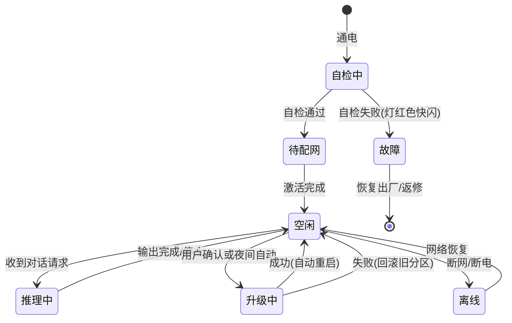

# 本地 AI 计算盒子产品需求文档（PRD）

**产品代号**：AI 小盒（暂定名，正式名称待品牌确认）
**文档版本**：v0.1（草稿）
**创建日期**：2026-10-09
**文档负责人**：[待确认]
**评审状态**：待评审

| 版本 | 日期 | 变更内容 | 作者 |
|------|------|----------|------|
| v0.1 | 2026-10-09 | 初稿创建 | [待确认] |

---

## 1. 需求背景

大模型对话已经成为日常工具，但主流方案把对话数据全部送往云端。关注隐私的用户（家庭、律师、医生、中小企业）没有可放心使用的本地方案；想自建的用户需要自己组装迷你主机、安装系统、部署推理框架、配置端口，整套流程的门槛把绝大多数普通用户挡在门外。

当前市场存在两类现成选择，都不理想：

- **智能语音硬件（如小智 AI 生态）**：硬件便宜、语音体验好，但设备算力弱，大模型推理依赖官方服务器或自行搭建后端（来源：CSDN 本地部署教程、即刻社区评测，2025）。
- **DIY 本地方案（迷你主机 + Ollama 等）**：数据留在本地、模型丰富（Qwen、DeepSeek-R1、Llama 等，来源：头条/Ollama 百科，2025），但用户要自己处理系统安装、模型下载、接口暴露等安全问题（来源：头条安全分析文章，2025），且缺少为手机、平板、电脑统一设计的客户端。

边缘 AI 盒子市场整体在增长，低延迟、数据隐私、就近计算是核心驱动力（来源：格隆汇《中国 AI 边缘推理盒子市场现状及未来趋势报告 2026》）。[假设—待确认] 隐私敏感且不愿折腾的消费者与小微企业存在未被满足的"开箱即用本地大模型"需求。

**不解决的后果**：这类用户继续使用云端服务并承担数据外流风险，或者放弃使用大模型；本项目错过硬件 + 本地 AI 的窗口期。

**证据强度标注**：竞品能力对比为 [研究支撑]（见第 4 章来源）；目标用户规模与付费意愿为 [假设]，需在 MVP 前做用户访谈验证。

---

## 2. 产品定位与目标

### 2.1 定位

一款开箱即用的本地大模型计算盒子：大模型完全在盒子上运行，对话与生成结果通过局域网实时推送到手机 App、平板和电脑浏览器；核心功能断网可用，数据默认不出家门。

**服务对象**：隐私敏感的个人与家庭用户、10 人以内的中小企业（律所、诊所、设计工作室等）、关注数据主权但缺乏动手能力的知识工作者。

**不服务对象**：需要超大模型（70B+）极致效果的重度用户、需要 GPU 集群的团队、把盒子当作游戏机或 NAS 的用户。

**核心差异点**：现有方案要么"算力在云上"（语音玩具），要么"体验靠自己搭"（DIY 方案）。本产品补中间空档——本地算力 + 出厂调优 + 三端统一的多屏客户端。多屏体验（手机 + 电脑网页同步展示推理结果）是 DIY 方案最弱的一环，也是本产品的主要差异化。[假设—待确认]

### 2.2 MVP 范围

第一期只闭环一条核心路径：**开机 → App 配对 → 选一个预装模型 → 手机/网页发起对话 → 流式看到结果**。

| 纳入 MVP | 延后（Phase 2+） |
|----------|------------------|
| 盒子硬件（无语音基础版）、文本对话、模型下载与切换、手机 App + Web 端、多用户、OTA 升级、隐私数据管理 | 语音对话、本地知识库问答（RAG）、公网远程访问、智能体预设商店、API 开放接口 |

### 2.3 产品目标（可验收）

| 目标 | 指标 | 目标值 |
|------|------|--------|
| 激活顺畅 | 从开机到首次对话成功的完成率 | ≥ 90% |
| 响应够快 | 局域网内首字延迟 P95（7B 量化模型） | ≤ 1.5 秒 [目标值，EVT 阶段验证] |
| 生成流畅 | 同条件生成速度 | ≥ 8 tokens/秒 [目标值，EVT 阶段验证] |
| 断网可用 | 核心对话功能在无外网时可用率 | 100% |
| 用户回来 | 激活后 7 日留存 | ≥ 40% [目标值，无基线，待内测校准] |
| 质量底线 | 硬件月退货率 | ≤ 2% |

---

## 3. 用户与使用场景

### 3.1 用户画像

| 画像 | 说明 |
|------|------|
| 隐私敏感家庭主用户（主要购买决策者） | 30–50 岁，技术熟练度中等，每周高频使用 AI 写作、翻译、辅导孩子功课；对"对话上传云端"有明显顾虑；愿意为一次性硬件付费，拒绝按月订阅；购买决策权：付费者本人 |
| 同住家庭成员（次要用户） | 配偶、老人、学生；技术熟练度低，只装 App 扫码即用；使用频率中低；无购买决策权但影响口碑 |
| 小微企业知识工作者 | 律师、医生、设计师；处理客户敏感材料，明令禁止外传；每周数次摘要、草拟、检索；由老板或 IT 兼职担任设备管理员 |

### 3.2 角色划分

| 角色 | 权限 | 典型动作 |
|------|------|----------|
| 设备管理员（首个绑定制创建） | 全部权限：绑定/解绑成员、模型管理、系统设置、日志导出 | 添加家庭成员、删除模型、重置设备 |
| 普通成员 | 自己的会话与个人设置；查看设备状态 | 对话、管理自己的历史、切换面向用户的偏好 |
| 访客（P2） | 仅临时会话，不留历史 | 临时借用 |

### 3.3 核心场景（按优先级）

1. **家庭写作助手**：用户在电脑浏览器写邮件卡壳，打开网页端继续上午在手机上发起的会话，盒子把上下文带回，追问一句即得续写。前提：手机与盒子在同一 WiFi。
2. **敏感材料摘要**：律师把客户合同粘贴到手机 App，请求要点摘要。全程数据只在手机与盒子之间传输；结束后一键删除该会话。
3. **断网应急**：家庭宽带上行故障，孩子在平板上继续用盒子辅导功课，体验不降级（仅模型下载等云依赖功能不可用并有明确提示）。
4. **多成员共用**：夫妻各自账号独立历史；管理员给老人绑定"大字体 + 简洁模式"。
5. **模型更换**：用户觉得默认模型答得太简略，在 App 模型页下载更大的模型并设为默认，等待期间旧模型继续可用。

---

## 4. 竞品与市场研究

### 4.1 研究对象

| 竞品 | 定位 | 目标用户 | 规模/商业化 | 亮点 | 来源（检索时间 2026-10） |
|------|------|----------|-------------|------|------|
| 小智 AI 聊天机器人（开源生态） | 低成本 AI 语音硬件 + 开源固件 | 硬件爱好者、入门开发者 | 开源社区约 9.2k+ Stars（2025-01 快照）；社区服务器 + 自建两种接入 | 离线唤醒、流式对话、5 语种识别、声纹识别、WiFi/4G | 头条推荐文、即刻评测、CSDN 部署教程、导航站收录 |
| 迷你主机/Mac mini + Ollama（DIY 替代方案） | 通用本地推理软件栈 | 极客、开发者 | Ollama 2023-07 上线，支持 Qwen、DeepSeek-R1、Llama 等 | 数据完全本地、模型生态最丰富、接口标准化 | 头条工具介绍、掘金教程、Ollama 百科 |
| 工业边缘计算盒子（RK3588 类） | B2B 视觉分析盒子 | 安防、能源、零售行业客户 | 厂商规模化出货（规模数据未公开） | 6 TOPS NPU、16 路 1080P 并发接入、工业级可靠性 | 飞凌官网、电子发烧友 DIY 教程 |
| Home Assistant + LLM | 开源智能家居平台叠加大模型 | 智能家居极客 | 开源社区，商业化有限 | 与全屋设备联动、社区集成丰富 | PHP 中文网指南、头条教程 |

### 4.2 研究结论

- **格局两极**：便宜的语音硬件把大模型放在云上（隐私与断网能力受限）；真正本地的方案要求用户自己搭建（激活与多端体验无人负责）。中间的"开箱即用 + 本地推理 + 多屏客户端"目前没有成熟产品占位。[研究支撑]
- **DIY 方案的安全与体验短板可转化为卖点**：Ollama 默认暴露本地接口带来安全隐患（来源：头条安全分析，2025），自建用户也很难获得手机/电脑一致的多端体验。本产品把"局域网加密 + 配对鉴权 + 三端同步"做成出厂能力。
- **工业盒子不构成直接竞争**：其形态、价格与交互面向视觉场景的 B2B 项目交付，不面向家庭对话助手。
- **主要威胁**：小米、百度等大厂若推出同类硬件，渠道与价格优势明显；需以先发、隐私口碑与多端体验建立心智。[专家判断]
- **市场量级**：目标细分市场规模与定价接受度 [待确认—需专项调研或付费报告]。

---

## 5. 功能需求

### 5.1 功能总览

| # | 模块 | 功能描述 | 优先级 |
|---|------|----------|--------|
| F1 | 开箱与激活 | 通电自检 → 手机 App 扫码/蓝牙引导配网 → 创建管理员 → 选择预装模型 → 完成激活。全程 ≤ 10 分钟；失败时给出可操作的下一步 | P0 |
| F2 | 对话交互 | 手机 App 与 Web 端文本对话：流式输出、停止/重新生成、多会话管理、上下文继承；输入单轮 ≤ 8K tokens（超出提示截断策略） | P0 |
| F3 | 模型管理 | 模型列表（预装 1 个 + 可下载若干）：查看参数量/内存占用/速度预估、下载（断点续传）、切换默认、删除；切换期间旧模型继续服务 | P0 |
| F4 | 多端与同步 | 手机 App（iOS/Android）、Web 端（浏览器）登录同一账号；会话列表与设置实时同步；扫码登录 Web 端 | P0 |
| F5 | 设备管理与 OTA | App 内查看设备状态（在线/推理中/升级中/离线）、重启、恢复出厂；固件 A/B 分区升级，失败自动回滚 | P0 |
| F6 | 隐私与数据控制 | 全部会话数据默认仅存于盒子；按会话/按用户/全盘三级删除；数据导出（明文 JSON）；匿名遥测默认关闭、开启需二次确认 | P0 |
| F7 | 多用户与权限 | 管理员邀请成员（≤ 8 人）；成员间会话与个人设置完全隔离；移除成员即删除其数据 | P1 |
| F8 | 异常与状态提示 | LED 表达核心状态；App 推送：存储不足、高温降频、模型下载失败、设备离线；异常文案必须附带"怎么办" | P1 |
| F9 | 智能体预设 | 预置人设/系统提示词模板（写作、翻译、辅导等 ≤ 10 个）；用户可自建并仅自己可见 | P1 |
| F10 | 语音对话 | "按住说话"起步，二期免唤醒词打断；本地识别 + 盒子推理 + 本地合成；结果显示在屏幕同时朗读 | P2 |
| F11 | 本地知识库 | 上传文档（PDF/TXT/DOCX，单文件 ≤ 50MB），仅本机解析与检索，回答附带出处段落 | P2 |
| F12 | 远程访问 | 出门后经加密中继访问自家盒子；默认关闭；开启时明确告知中继仅见密文 | P2 |

### 5.2 系统架构与数据流

数据默认不出局域网；云端仅承担可选服务（模型下载 CDN、固件升级、匿名遥测），全部可关闭。

文本对话核心链路（MVP）：

### 5.3 F1 开箱与激活

- **业务逻辑**：激活成功的判定标准是"完成一次真实对话"，而非仅完成绑定；未完成对话的设备在 App 首页持续展示"完成激活"引导。
- **交互逻辑**：扫码失败 3 次自动提供手动输入设备编号入口；配网密码错误即时反馈不清空已输入内容。
- **规则约束**：管理员账号名 2–20 字符；WiFi 仅支持 2.4G/5G WPA2/WPA3 [待确认—模组选型后冻结]；一个盒子同一时刻仅允许一个激活流程进行中。
- **边界与异常**：断电重启后从"已配网待绑定"状态恢复；30 天未绑定则提示恢复出厂；同账号绑定设备数 ≤ 3 台。

### 5.4 F2 对话交互（手机端）

- **业务逻辑**：用户发送 → 盒子按会话上下文推理 → 流式返回 → 完整消息落盘盒子。重新生成不覆盖原输出，追加一条并标记版本。
- **交互逻辑**：推理中发送键变停止键；点击停止立即截断并把已生成部分保存；长按消息可复制/删除；下拉加载更早历史。
- **规则约束**：单轮输入 ≤ 8K tokens，超出时提示将截断最早内容并需用户确认；单会话轮数上限 200 轮，达到后提示开启新会话；会话标题自动取首条消息前 12 字，可手动改（≤ 30 字符）。
- **权限逻辑**：成员仅见自己的会话；管理员可在成员被移除时选择保留或删除其数据。
- **边界与异常**：设备离线时输入区置灰并显示"盒子不在线——检查电源或 WiFi"；推理超时（120 秒无 token）自动终止并提示重试；盒子满负载（3 并发会话）时排队并显示预计等待位次。

### 5.5 F3 模型管理

- **业务逻辑**：下载完成前新模型不参与服务；"设为默认"对新会话生效，进行中的会话继续用原模型直到结束；删除正在使用的模型被禁止。
- **规则约束**：可下载模型由官方目录提供，每个条目标注参数量、量化等级、所需剩余存储（下载需 ≥ 模型体积 × 1.2）；本地最多保留 4 个模型 [待确认—按存储规格冻结]。
- **边界与异常**：下载中断可续传；校验失败自动重试 1 次后转手动；存储不足时禁止下载并引导清理。

### 5.6 F4 多端与同步

- **业务逻辑**：会话与设置的唯一数据源是盒子；端侧仅做缓存。同一会话在多端同时打开时，后发送的消息实时广播到其他端。
- **交互逻辑**：Web 端首次登录用手机 App 扫码授权；App 上"继续会话"入口直接恢复最近 3 条会话。
- **规则约束**：Web 端会话缓存 7 天自动清理；同一账号并发在线端 ≤ 3 个。
- **边界与异常**：两端同时发送消息按到达盒子时间串行处理并保持顺序一致。

### 5.7 F5 设备状态与 OTA

- **规则约束**：升级包自动校验签名，验签失败拒装；升级默认安排在 02:00–05:00，用户可改为"立即"；升级期间对话请求排队或提示（用户可取消排队）。
- **边界与异常**：升级中断电，重启后进入旧分区并回传失败日志（需用户已开启遥测，否则仅本地记录）。

### 5.8 F6 隐私与数据控制

- **业务逻辑**：会话、账号、设置只存盒内存储；删除操作即时生效并覆写存储块；导出功能生成明文 JSON 由用户自行保管。
- **规则约束**：遥测事件白名单制（仅稳定性相关，不含任何对话内容），默认关闭，开启需在"隐私页"二次确认并展示完整事件清单；恢复出厂前要求输入管理员密码并二次确认，倒计时 60 秒。
- **边界与异常**：盒子存储达到 95% 时自动提示，不自动删除任何用户数据。

---

## 6. AI 能力定义与评估

### 6.1 任务与输入输出

| 项目 | 定义 |
|------|------|
| 任务 | 中文为主的日常问答、写作与改写、总结、翻译；P2 增加文档问答 |
| 输入 | 文本，单轮 ≤ 8K tokens；P2 增加语音与文档 |
| 输出 | 流式文本；完成/停止/失败三种终态 |
| 质量维度 | 正确性、相关性、完整度、格式可读性、安全性（拒绝违法有害请求） |

### 6.2 评估体系

- **离线评测**：标准集 500 条中文通用任务 + 100 条边界样本（超长输入、诱导性提问、有害请求）+ 50 条回归样本。人工 5 分制评分，任务通过线：平均 ≥ 4.0 且单项任务通过率 ≥ 85%。[目标值]
- **在线反馈**：每条输出可点赞/点踩，点踩必选原因标签（错误/跑题/格式差/其他）；监控重问率（同会话 3 分钟内重述相似问题占比）与编辑率（复制后大幅修改无法直接度量，以重问率为主）。
- **Go/No-Go 门槛**：出厂模型离线通过线达标；首字延迟 P95 ≤ 1.5s；有害请求拒绝率 ≥ 98% [目标值，法务与安全评审后冻结]；出现数据越界（任何对话内容出现在遥测）即 No-Go。

### 6.3 降级与兜底

- 上下文超限：提示用户确认截断，不静默丢内容。
- 模型加载失败：自动回退到内置兜底小模型（仅保证基础问答）并在界面明确标注当前为降级状态。
- 任何情况下，模型输出不得触发对盒子系统的操作（不提供工具执行能力，MVP 阶段）。

---

## 7. 硬件与固件需求

### 7.1 硬件规格（需求口径，具体选型由硬件团队在 EVT 冻结）

| 项目 | 需求 |
|------|------|
| 计算 | CPU ≥ 8 核；NPU/GPU 满足 4-bit 量化 7B–14B 模型推理（性能目标见 2.3） |
| 内存 | ≥ 16GB |
| 存储 | ≥ 256GB NVMe，支持用户更换扩展 |
| 网络 | WiFi 6 + BLE（配对用）；1× 千兆网口 |
| 接口 | USB-C（PD 供电）、USB-A × 2、HDMI（仅诊断/首次配置用） |
| 音频 | 麦克风阵列 ×2 + 扬声器（P2 语音版硬件预留） |
| 指示与按键 | 状态 LED × 1（绿/橙/红三态）、电源键、恢复出厂针孔键 |
| 散热与噪音 | 0–40°C 工作；满载噪音 ≤ 35dBA @ 1m [目标值] |
| 功耗 | 待机 ≤ 8W；满载 ≤ 45W [目标值] |
| 整机 | 桌面立式/卧式，掌心大小，无风扇异物声 |

### 7.2 固件能力

- A/B 双分区升级，失败自动回滚；恢复模式支持 U 盘重刷。
- 首次开机注入设备密钥（配对与通道加密用），密钥不出安全存储区。
- 出厂镜像含一个默认可用模型，开箱即聊。

### 7.3 认证与合规（上市前完成）

SRRC（无线模块型号核准）、CCC（适用目录内的适配器/整机）、RoHS、GB 4943.1（信息技术设备安全）。生成内容合规：产品若附带官方模型目录与运营服务，需由法务评估《生成式人工智能服务管理暂行办法》适用性 [待确认—法务评审]；用户数据本地处理符合《个人信息保护法》最小必要原则。

### 7.4 生产测试与售后

- 产测：每台整机 NPU 推理冒烟测试（标准问题 3 条）、4 小时老化、序列号与密钥注入、外观与接口全检。
- 售后：整机 1 年质保；用户授权后可上传诊断日志（不含对话内容）；返修流程与备件策略 [待确认—供应链]。
- 成本：BOM 目标成本与定价 [待确认—需供应链报价与定价调研]。

---

## 8. 数据与埋点

埋点仅服务于两个决策：激活漏斗哪里流失、硬件与模型质量是否达标。全部埋点默认关闭，随用户开启遥测后才生效；事件不包含任何对话内容。

| 事件 | 触发时机 | 关键属性 | 服务决策 |
|------|----------|----------|----------|
| activate_step | 激活各步骤完成/失败 | 步骤名、失败原因码 | 定位激活漏斗流失点 |
| first_chat_done | 激活后首次对话完成 | 耗时、模型 ID、是否成功 | 验证"开箱即聊"目标 |
| chat_quality | 每次对话结束（抽样） | 首 token 延迟、tokens/s、终止原因 | 监控 2.3 性能目标 |
| model_op | 模型下载/切换/删除 | 模型 ID、操作结果 | 决定默认目录收录哪些模型 |
| ota_result | 升级完成 | 版本对、成功/回滚 | 固件质量门禁 |
| feedback | 点赞/点踩 | 评分、原因标签 | 模型更新与目录调整 |

**报表需求**：激活漏斗看板、性能监控看板（首 token 延迟/tokens/s 分位数）、固件升级成功率看板。基线与目标对比周期：内测期每周一次。

---

## 9. 依赖与风险

### 9.1 关键依赖

- **技术**：NPU 上主流开源模型（Qwen/DeepSeek 系等）的量化移植与推理框架适配；端到端加密通道方案；模型分发 CDN。
- **团队**：硬件（结构/电子/固件）、算法（模型移植与评测）、客户端（iOS/Android/Web）、后端（账号/目录/OTA/遥测）、供应链与质量。
- **外部**：SoC 供应商与 NPU 工具链支持、代工厂产能、开源模型许可条款（逐模型核对商用授权）、认证机构排期。

### 9.2 风险清单

| 风险 | 概率 | 影响 | 应对 |
|------|------|------|------|
| NPU 上模型移植性能不达标（首 token/吞吐） | 中 | 高 | EVT 阶段用参考设计先行压测 7B/14B 量化模型，作为选型硬门槛；不达标即换平台 |
| 开源模型许可限制商用或条款变更 | 中 | 高 | 官方目录仅收录明确可商用模型；逐模型留存许可快照 |
| 大厂同类产品入场挤压 | 中 | 高 | 以隐私口碑、多端体验与先发迭代节奏建立差异化；控制 BOM 保证价格弹性 |
| 激活流程失败率高导致退货 | 中 | 高 | 内测期以激活完成率 ≥ 90% 为放行门槛；失败原因实时上报 |
| 供应链交期与成本波动 | 中 | 中 | 双供应商策略；BOM 目标成本留 15% 余量 |
| 遥测/合规风险 | 低 | 高 | 遥测白名单 + 默认关闭；法务前置评审模型目录运营模式 |

---

## 10. 里程碑与迭代规划

团队规模与启动时间未定，以下用相对阶段表示 [待确认—需资源排期]。

| 阶段 | 内容 | 出口标准 |
|------|------|----------|
| M0 PRD/方案评审 | 冻结 PRD、硬件选型方向、成本框架 | 评审通过 |
| M1 EVT 工程验证 | 参考板跑通 7B/14B 量化推理；手机 Demo 打通流式链路 | 性能目标值实测达标 |
| M2 DVT 设计验证 | 结构手板 + App/Web Beta；激活流程完整可用；安全评审 | 内测激活完成率 ≥ 85% |
| M3 PVT 小批量试产 | 试产 200–500 台；产测工装就绪；认证送样 | 产测直通率 ≥ 95%；认证资料齐备 |
| M4 GA 上市 | 首批量产 + 公开销售；埋点看板上线 | 2.3 全部目标进入监控 |
| M5 Phase 2 | 语音对话、本地知识库、远程访问 | 按 Phase 2 PRD 评审 |

---

## 11. 验收标准（MVP 放行）

| 类别 | 验收项 | 通过标准 |
|------|--------|----------|
| 功能 | 激活、对话、模型管理、多端同步、OTA、隐私控制 | 第 5 章全部 P0 功能按描述逐条通过用例 |
| 性能 | 首 token P95 / 生成速度 / 并发 | 2.3 目标值在标准测试环境实测达标 |
| 可靠性 | 升级断电回滚、7×24 稳定性 | 连续 72 小时无重启；升级中断 100% 回滚成功 |
| AI 质量 | 离线评测、有害请求拒绝 | 6.2 Go/No-Go 门槛全部通过 |
| 合规 | SRRC/CCC/RoHS/GB4943.1、法务意见 | 证书齐备；合规评审留档 |
| 隐私 | 数据不出盒子验证 | 抓包测试：关闭遥测时盒子对外无业务流量（仅可选 CDN/OTA 域名检查请求） |
